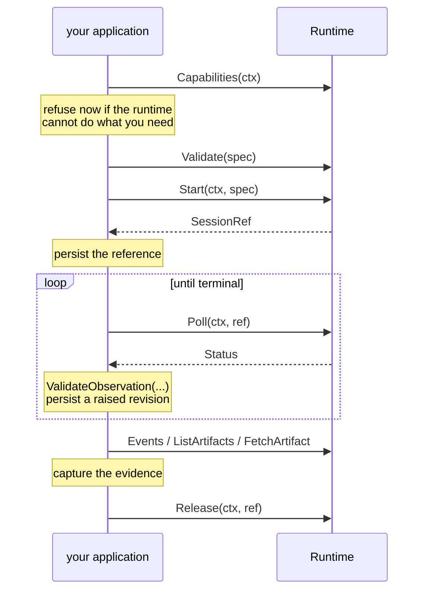

# Using the port

For an application that runs sessions. You choose a runtime, describe the work, and drive it to an end.

## The shape of a run



The order matters in one place: **capture before you release**. After `Release` the transcript and the artifacts are gone.

## Describing the work

```go
spec := managed.SessionSpec{
    Model:        managed.ModelSelector{Preference: "balanced"},
    Instructions: "You are a careful research engineer.",
    Task:         "Run the analysis and write results.md to the output directory.",
    Sandbox: managed.SandboxSpec{
        Packages: []managed.Package{{Manager: "pip", Name: "pandas", Version: "2.2.3"}},
        Network:  managed.NetworkPolicy{Mode: managed.NetworkNone},
    },
}
if err := spec.Validate(); err != nil {
    return err
}
```

`Instructions` is the worker's standing role. `Task` is this session's request. Keep them apart even for a runtime that joins them on the wire, because the split is what lets you reuse a role across sessions.

**Where to write output.** Do not hard-code a path. `Capabilities.OutputDir` is where the runtime expects a session's results, and you template it into the instructions:

```go
capabilities, err := runtime.Capabilities(ctx)
spec.Task = fmt.Sprintf("Run the analysis and write results.md to %s.", capabilities.OutputDir)
```

**Network.** The zero value is the closed sandbox, not the open one. `NetworkAllowlist` is the only mode that may carry secrets, and every secret is bound to a domain the allowlist names:

```go
Network: managed.NetworkPolicy{
    Mode:           managed.NetworkAllowlist,
    AllowedDomains: []string{"files.example.org"},
    SecretRefs:     map[string]string{"FILES_TOKEN": "files.example.org:token"},
},
```

A specification carries secret *references*, never values. Supply the values for one call with `managed.WithSecrets`, which puts them on the context where only the adapter can read them:

```go
ctx = managed.WithSecrets(ctx, map[string]string{"files.example.org:token": token})
ref, err := runtime.Start(ctx, spec)
```

This is why a specification is safe to log, store, and hand around: there is nothing secret in it.

## Giving the session inputs

Two kinds, and the difference is deliberate.

An **attachment** is a file the session reads and must not commit. It lands outside every repository:

```go
body, _ := os.ReadFile("cohort.csv")
digest := sha256.Sum256(body)
spec.Resources = append(spec.Resources, managed.Resource{
    Kind: managed.ResourceAttachment,
    Attachment: &managed.AttachmentResource{
        Path:    "inputs/cohort.csv",
        Content: body,
        SHA256:  hex.EncodeToString(digest[:]),
    },
})
```

Validation recomputes the digest, so a corrupted payload fails the specification rather than the run.

A **repository** is a place the session works in, and may push to when you ask for it:

```go
spec.Resources = append(spec.Resources, managed.Resource{
    Kind: managed.ResourceRepository,
    Repository: &managed.RepositoryResource{
        URL:           "https://github.com/you/work.git",
        Destination:   "work",
        Access:        managed.AccessReadWrite,
        CredentialRef: "forge:write",
    },
})
```

`AccessReadOnly` states intent. What actually prevents a push is the credential's own scope, so give a read-only destination a read-only credential.

## Grading

A session is graded only when it carries an evaluation:

```go
spec.Evaluation = &managed.EvaluationSpec{
    Rubric:       "results.md reports the effect size and its confidence interval.",
    MaxRevisions: 3,
}
```

A graded session finishes with a decided `Verdict`. An ungraded one finishes with none. Not every runtime can grade — check `Capabilities.Evaluation` and expect `ErrUnsupported` when it cannot.

## Driving it

The port has no loop, so here is one. What matters is not the timing but the three things the loop owes you: it validates every observation, it persists a raised revision before calling the runtime again, and it captures the evidence before releasing.

```go
func run(ctx context.Context, rt managed.Runtime, spec managed.SessionSpec, save func(managed.SessionRef) error) error {
    if err := rt.Validate(spec); err != nil {
        return err
    }
    ref, err := rt.Start(ctx, spec)
    if err != nil {
        return err
    }
    if err := save(ref); err != nil { // a started session must never be invisible
        return err
    }

    grading := managed.GradingNotRequested
    if spec.Evaluation != nil {
        grading = managed.GradingRequested
    }

    var previous managed.Status
    delay := 2 * time.Second
    for {
        status, err := rt.Poll(ctx, ref)
        if err != nil {
            if !managed.IsTemporary(err) {
                return err
            }
            // Retryable. Back off and try again, within whatever budget you
            // have decided an unresponsive runtime deserves.
        } else {
            if err := managed.ValidateObservation(ref, rt.Name(), previous, status, grading); err != nil {
                return err // the runtime broke the contract; nothing after this is trustworthy
            }
            if status.Ref.Revision > ref.Revision {
                if err := save(status.Ref); err != nil {
                    return err
                }
                ref = status.Ref
            }
            previous = status
            if status.State.Terminal() {
                break
            }
        }
        select {
        case <-ctx.Done():
            return ctx.Err()
        case <-time.After(delay):
        }
        delay = min(delay*2, 15*time.Second)
    }

    events, err := rt.Events(ctx, ref)     // capture...
    if err != nil {
        return err
    }
    artifacts, err := rt.ListArtifacts(ctx, ref)
    if err != nil {
        return err
    }
    if err := keep(events, artifacts); err != nil {
        return err // do NOT release: the session is still recoverable
    }
    return rt.Release(ctx, ref)            // ...then release
}
```

Three details are load-bearing:

- **Persist the reference before the first poll.** A session that started remotely and is invisible locally is the worst outcome available: it costs money and nobody can reach it.
- **Persist a raised revision before calling the runtime again.** A revision moving up is the runtime checkpointing itself. Skip the save and a crash leaves you holding a stale handle.
- **Do not release if you failed to keep the evidence.** An unreleased session can be resumed. A released one cannot be read.

## Resumability

```go
capabilities, _ := rt.Capabilities(ctx)
if !capabilities.Resumable {
    // Session handles from this runtime die with this process.
}
```

When `Resumable` is true, a reference you saved can be loaded by a different process later and still names a live session — so a restart resumes rather than loses. When it is false, the handle is meaningful only in the process that created it.

Decide at admission. A service that must survive restarts should refuse a non-resumable runtime at the door, not discover the difference during a deploy.

## Errors

Match the class, never an adapter's own type:

| Error | Means | Do |
|---|---|---|
| `ErrInvalidSpec` | The specification is wrong on its own terms. | Fix the input. `InvalidSpecError.Field` names it. |
| `ErrUnsupported` | Well-formed, but this runtime cannot do it. | Choose another runtime, or drop the request. Never retry. |
| `ErrRuntimeMismatch` | A reference went to the adapter that did not start it. | A routing bug. Route on `ref.Runtime`. |
| `ErrNotFound` | The session or artifact is gone. | Legitimate after a release or an expiry. |
| `ErrContract` | The runtime broke a rule. | Stop. Nothing it reports afterwards can be trusted. |

`managed.IsTemporary(err)` reports whether anything in the chain claims to be retryable. The test is structural, so an adapter can pass a transport's own retryable error through without wrapping it. If the error carries `RetryAfter()`, treat it as a floor on your backoff, not as a schedule.

## Testing without a vendor

```go
rt := memory.New()                       // deterministic, in-process, no network
rt = memory.NewWithStore(store, memory.Config{
    PollsBeforeDone: 3,                  // how long a session takes
    Grade:           managed.GradeNeedsRevision,
    Files:           map[string][]byte{"outputs/results.md": []byte("...")},
    Failures:        map[memory.FailurePoint]error{memory.FailPoll: errBoom},
})
```

`Failures` drives one call's error path without a fake runtime wrapped around a real one, which is what makes your own error handling testable. Rebuilding a `Runtime` around the same `Store` is what a process restart looks like; `Config{NonResumable: true}` gives you a runtime that loses its sessions instead, so you can test both branches of the capability check.
