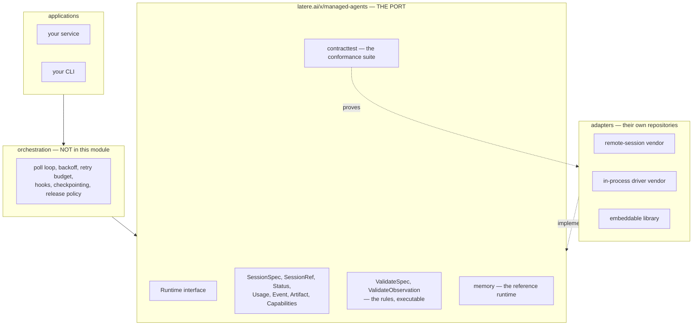

# 001 — The managed-agent port

**Status:** designed.

**Scope:** one provider-neutral contract for running a graded, sandboxed, tool-using session; the rules an adapter must obey; the conformance suite that proves it obeys them; a reference runtime; and the JSON Schema the contract is generated from. Adapters for named vendors are out of scope and live in their own repositories.

**Depends on:** nothing. The module has no dependency outside the standard library.

## Problem

Three vendors sell the same capability — run a long-lived, tool-using worker inside a sandbox, let it read and write files, and give me back what it did — and no two of them shape it alike.

- One exposes a **remote session**. You create it, you get an identifier, you poll it from any process, you read its transcript, you release it. The session outlives the process that started it.
- One exposes an **in-process driver over a hosted sandbox**. A blocking call drives the model loop on your machine; the sandbox is remote and the loop is not. Continuation works by serialising session state to your own storage and resuming from it.
- One is an **embeddable library**. Everything runs in your process. There is no identifier, no polling, and nothing to recover: if the process dies, the run died with it.

An application that wants to support more than one of these has three bad options. It can write to the widest vendor and stub the rest, which makes the stubs lie. It can write to the narrowest, which throws away the durability the first vendor actually offers. Or it can branch per vendor at every call site, which is the thing an interface exists to prevent.

The failure is not the shape mismatch on its own. It is that the mismatch is **silent**. A blocking in-process runner can be wrapped to look like a pollable session — spawn a goroutine, hand back a process-local identifier, answer polls from shared memory. It passes every compile check and every happy-path test. It breaks the first time a process restarts, and it breaks as a lost run rather than as an error.

So the port has to do two things a bare Go interface does not do:

1. **Let a runtime declare what it cannot do**, before anything remote is created, so a request for durability against a runtime that has none is refused rather than accepted and later lost.
2. **State the rules that are not in the type signatures** — usage is cumulative, state moves forward only, evidence is readable until release — and make them executable, so a third-party adapter can prove it conforms instead of asserting it.

## What the port is, and is not



**In:** the `Runtime` interface, the data types that cross it, the errors it returns, the validation of a specification, the validation of one observation against the previous one, the conformance suite, and a deterministic in-memory reference runtime.

**Out:** the poll loop and its timing. How long to wait between polls, how many consecutive failures to tolerate, how long silence may last before a session is declared timed out, whether a failed evidence handoff blocks release — every one of those is a policy an application chooses, not a claim about what a vendor does. A module that shipped them would be shipping one application's operational taste as though it were the protocol.

The line is drawn at a single question: *does this statement constrain what an adapter must do, or what a caller should do?* The first belongs here. The second does not.

## The three shapes, measured

The port claims to cover three execution models. That claim is worth nothing unstated, so here is each one against the surface it has to reach.

| Vendor shape | Run is started by | Handle survives process death | Status is | Events are | Artifacts | Cancellation | Grading |
|---|---|---|---|---|---|---|---|
| Remote session | a create call returning an id | **yes** — poll from anywhere | polled | pulled after the fact | listed and fetched by id | a cancel call | first-class |
| In-process driver, hosted sandbox | a blocking call on your goroutine | **only** if you serialise session state yourself | not exposed | returned in the result | sandbox-provider specific | close the session | none |
| Embeddable library | a blocking call, in your process | **no** | not exposed | pushed to an observer during the run | files in the sandbox working directory | cancel the context | none |

Five of the seven columns are already expressible, because the port already carries a capability for each:

- **Events.** A runtime that pushes events during a run buffers them and answers `Events` from the buffer. `Capabilities.DurableEvents` distinguishes a buffer that dies with the process from a transcript the vendor stores.
- **Artifacts.** `Capabilities.Artifacts` is false where a runtime cannot enumerate what a run produced, and `ListArtifacts` refuses rather than returning an empty list that reads as "it produced nothing".
- **Cancellation.** `Capabilities.Cancellation` is false where a run cannot be stopped once started.
- **Grading.** `Capabilities.Evaluation` is false, and a specification carrying an `Evaluation` block is refused with `ErrUnsupported` before anything remote is created. This is the case the capability model was built for and it needs no change.
- **Status.** Every shape can answer "where has this got to", because an adapter over a blocking call knows whether its goroutine has returned.

One column is **not** expressible, and it is the important one.

## The shape change: durability is declared, not assumed

`SessionRef` is documented as the durable handle to a session — everything needed to poll it, read its evidence, cancel it, and release it *after the process that started it has gone*. For a remote session that is true. For an embeddable library it is false, and there is no field in `Capabilities` that says so.

`DurableEvents` does not cover it. That flag says the *evidence* may not survive; it says nothing about the *handle*. A caller reading `DurableEvents: false` learns it should capture the transcript before releasing. It does not learn that persisting the reference and reloading it after a restart will find nothing.

The fix is one flag:

```go
// Resumable reports whether a SessionRef survives the process that created
// it. When true, a reference persisted now can be handed back to a fresh
// process later and will still name a live session. When false the reference
// is meaningful only inside the process that started the session: an adapter
// over an in-process runtime declares false, and a caller that needs to
// survive a restart must refuse the runtime rather than discover the loss
// when a restart happens.
Resumable bool
```

and one correction to `SessionRef`'s own documentation, which stops asserting durability universally and starts deferring to the declaration.

This is deliberately a capability rather than a second interface. Splitting `Runtime` into resumable and non-resumable variants would push the branch back into every caller, which is the problem the port exists to remove. A flag keeps one interface and moves the decision to one place: a caller that requires durability checks `Capabilities` once, at admission, and refuses.

The conformance suite gains the matching case. A runtime declaring `Resumable: true` must answer `Poll` for a reference reconstructed from its serialised form; a runtime declaring false must answer `ErrNotFound`, never a fabricated status.

## The rules a schema cannot carry

The types describe shapes. The protocol is mostly rules about *sequences of values*, and no JSON Schema expresses any of them:

1. **Usage is a cumulative session total, never a delta.** No bucket and no meter may decrease between two observations. A runtime reporting per-call deltas is not merely inconvenient; a caller summing the observations bills several times over.
2. **State moves forward only.** `pending → running → done|failed`. A terminal observation stays terminal, whatever it is polled again.
3. **The resolved model never changes mid-session.** What the session is billed at is fixed once the runtime reports it.
4. **A graded session ends with a decided verdict; an ungraded one never carries one.** Neither half is optional: a verdict on a session nobody asked to grade is as much a contract violation as a graded session finishing undecided.
5. **Evidence is readable until `Release`.** Capture precedes release, and `Release` is idempotent. After it, `Events`, `ListArtifacts`, and `FetchArtifact` return `ErrNotFound`.
6. **`Validate` is pure and total.** It consults nothing remote, and a specification it accepts is one `Start` may still refuse only for reasons outside the specification (a credential, a quota) — never for a property of the specification itself.
7. **The locator is opaque and versioned.** A caller stores it byte for byte and never parses it. It carries no credential and no user content, and it is size-limited.

These are the module's actual content. A generated struct in another language reproduces the shapes and none of the rules, which is why the user-facing documentation states them in language-neutral prose and `contracttest` states them as executable Go.

## `ValidateObservation` becomes public

Rule 1 through rule 4 are enforced today only by an application's own poll loop, which means an adapter written against the bare interface has no way to discover it has broken them. The check moves into this module and becomes part of the surface:

```go
// Grading is what the caller knows about whether grading was requested.
type Grading int

const (
    // GradingUnknown is a session observed through a persisted reference,
    // which does not record whether the original request asked for grading.
    // A verdict is checked for coherence but its absence is not a violation.
    GradingUnknown Grading = iota
    // GradingRequested is a session whose specification carried an evaluation.
    GradingRequested
    // GradingNotRequested is a session whose specification did not.
    GradingNotRequested
)

// ValidateObservation reports whether current is a legal successor to
// previous for the session named by expected. A zero previous is the first
// observation.
func ValidateObservation(expected SessionRef, runtime RuntimeName, previous, current Status, grading Grading) error
```

Two deliberate differences from a poll loop's private helper. It takes a `RuntimeName` rather than a `Runtime`, because it reads only the name and requiring the interface would make it uncallable from a test holding nothing but data. And the tri-state that a bare `*bool` was encoding gets a name: `nil` meant "observed through a persisted reference, which does not record whether grading was requested", and that is worth saying rather than inferring.

`contracttest` calls it on every observation it makes, so conformance and the runtime rules are the same rules.

## Schema first

The JSON Schema is the contract. Go types are generated from it, so a later TypeScript or Python port generates from the same source and cannot drift from Go by construction.

```
schema/*.json  ──┬── go generate ──→ types.gen.go
                 ├── (later) ──────→ TypeScript
                 └── (later) ──────→ Python

hand-written Go, behaviour only:
  runtime.go       the Runtime interface and Capabilities
  methods.go       methods on generated types
  errors.go        the error classes and typed errors
  validate.go      ValidateSpec, ValidateObservation
  secrets.go       request-scoped secret resolution
  contracttest/    the conformance suite
  memory/          the reference runtime
```

`github.com/google/jsonschema-go` parses and marshals the schema. It preserves `PropertyOrder`, so generated field order follows the schema's declaration order rather than an alphabetical sort, and it keeps unknown keywords in `Schema.Extra`, so the annotations below survive a round trip. It does not generate code; the generator is `internal/gen`, in this module, and is a build-time tool rather than a dependency of anything a consumer imports.

### The annotations

Four things a general-purpose generator cannot infer, declared as `x-` keywords:

| Keyword | On | Effect |
|---|---|---|
| `x-go-name` | property, `$def` | Overrides the derived Go identifier. `id` becomes `ID`, `sha256` becomes `SHA256`, `url` becomes `URL`. |
| `x-go-type` | property | Emits a named Go type instead of the structural one. `locator` becomes `json.RawMessage`; a raw payload is stored and returned, never parsed. |
| `x-go-key-type` | object with `additionalProperties` | Types a map's key. `extra` becomes `map[Meter]int64`, not `map[string]int64`. Paired with `propertyNames` in the schema so the constraint is language-neutral too. |
| `x-go-open` | string `$def` with `enum` | Emits the named type and its constants but no closed validation. `EventKind` and `Meter` are deliberately open: a runtime-native event kind passes through unchanged rather than being dropped or coerced into a neighbour. |

The named constants carry their own `description`, so a constant's meaning survives into the generated Go doc comment rather than being lost to a bare `const` block.

### Order of work

The schema is written **after** the Go types, not before, and this is deliberate.

1. Write the Go types, the methods, the errors, the validation, the interface, the conformance suite, and the reference runtime by hand.
2. Get the tests green. That is the proof the port is coherent; nothing else is.
3. Write `schema/*.json` to reproduce those types exactly, generate, and replace the hand-written type file with the generated one. **The same tests must stay green**, and the generated file must be identical in shape to what it replaced.

Doing it the other way round discovers the generator's gaps at the end, when the conformance suite and the reference runtime are already built on whatever the generator happened to emit. Step 3's diff is the review: if the generated types differ from the hand-written ones, either the schema is wrong or the annotation set is short a keyword.

## Distribution

The module is `latere.ai/x/managed-agents` and the package is `managed`, so the contract reads `managed.Runtime`, `managed.SessionSpec`, `managed.ErrUnsupported`.

The repository is private, which is a first for this module namespace and costs every consumer one configuration step:

```
GOPRIVATE=latere.ai/x/*
git config --global url."https://<token>@github.com/latere-ai/".insteadOf "https://github.com/latere-ai/"
```

Continuous integration needs the same, through a token with read access to the repository. This is a prerequisite for the first consumer, not a follow-up: without it `go get` fails at the proxy with a message that does not name the cause.

## Acceptance

- `go test ./...` passes with the race detector, and coverage is above 90% for the module.
- `contracttest.Run` passes against the reference runtime, including the new resumability case in both declarations.
- Every rule in *The rules a schema cannot carry* has at least one test that fails when the rule is broken.
- `go generate ./...` reproduces `types.gen.go` byte for byte from `schema/`, and a test asserts it — a schema edit that is not regenerated fails the build.
- Golden JSON for every wire type validates against its schema, checked with `Resolved.Validate`.
- The module imports nothing outside the standard library. A test asserts it.
- `README.md` states the seven rules in prose, without Go in the statement of any of them.

## Non-goals

- **Adapters.** No vendor adapter lives here. The reference runtime answers in memory and reaches no network.
- **Streaming.** `Events` is pull-after-the-fact. A runtime that pushes events buffers them. Live streaming to a caller is a later addition and would be a new optional interface, not a change to this one.
- **The poll loop.** Stated above and repeated because it is the tempting one.
- **Cost.** `Usage` reports quantities. Turning quantities into money needs a rate card, which is a different concern with a different release cadence.
